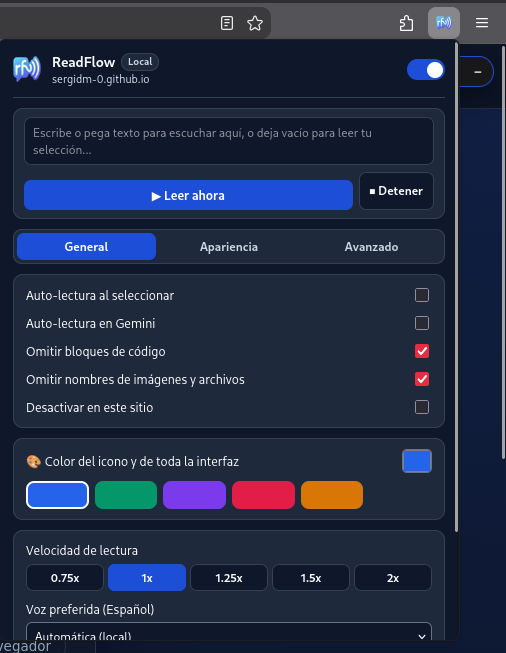
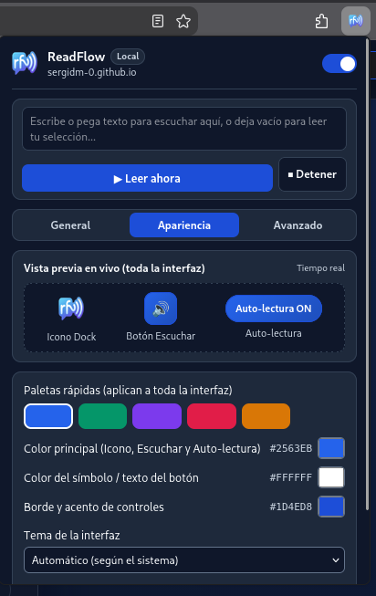
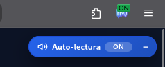

<p align="center">
  
</p>

# ReadFlow

> **Extensión de navegador 100 % local de síntesis de voz neuronal (Piper ONNX + WebAssembly) con streaming procedural incremental, auto-lectura universal acoplable a cualquier esquina y personalización de color en tiempo real.**

[](LICENSE)
[](manifest.chrome.json)
[](https://sergidm-0.github.io/ReadFlow/)
[](PRIVACY.md)
[](SECURITY.md)
[](scripts/check-size.mjs)

---

## Demo y capturas

https://github.com/user-attachments/assets/6884d852-4105-4b35-a5e9-e93df1a7d4fe

| Lectura en vivo y Mini-reproductor | Panel de configuración (General) |
|---|---|
|  |  |

| Personalización de apariencia | Auto-lectura acoplable |
|---|---|
|  |  |

---

## Características principales


### 1. Motor neuronal suave 100 % local y arranque casi instantáneo

- **Piper Neural TTS por defecto (`piper-neural`):** Ejecuta síntesis neuronal VITS en local mediante `onnxruntime-web` (SIMD) y `@diffusionstudio/piper-wasm` (`espeak-ng` compilado a WebAssembly con instancia persistente `noExitRuntime: true`). Incluye voces suaves curadas (`es_MX-claude-high` para español, `en_US-hfc_female-medium` para inglés y voces en ES/EN/PT/FR/DE/IT) que se descargan una sola vez en `Cache Storage` (`readflow-piper-models-v1`) y luego funcionan **100 % offline**.
- **Streaming procedural incremental (`createProceduralTextStream`):** Procesa textos grandes bajo demanda en ventanas de ~640 caracteres con una **rampa de apertura rápida** (`48 → 95 → 140 → 175` caracteres) y pre-síntesis paralela de los próximos 2 fragmentos (_lookahead_), manteniendo el tiempo al primer audio en `O(1)` sin importar el tamaño del documento.
- **Velocidad en vivo con tono humano natural (`0.75x` – `2x`):** Reproduce con `HTMLAudioElement` (`preservesPitch = true`) para que cambiar de velocidad en mitad de una frase sea instantáneo (`0 ms`), no altere el timbre de la voz y no invalide los fragmentos pre-sintetizados (con fallback automático a `AudioContext` persistente si el CSP de una página bloquea `blob:`).
- **Motores intercambiables (`TTSEngineInterface`):** Cambia en cualquier momento entre **Piper Neuronal Local**, **Web Speech API** (con ranking de voces naturales y corrección de pausa/reanudación en Linux `speech-dispatcher`) o **Endpoint HTTP Local** (`http://127.0.0.1:5000/tts` / Kokoro OpenAI-compatible).

### 2. Interfaz personalizable, acoplable y sin colisiones

- **Color unificado para toda la interfaz y el icono del dock:** Desde el icono anclado en la barra o desde **Administrar extensión (`options_ui`)**, elige entre 6 paletas rápidas (`Zafiro`, `Esmeralda`, `Violeta`, `Coral`, `Ámbar`, `Grafito`) o un color libre (`#RRGGBB`). El color elegido actualiza **al mismo tiempo**:
  1. El **icono anclado en el dock/barra del navegador** (renderizado en vivo vía `OffscreenCanvas` → `browser.action.setIcon`).
  2. El **botón flotante de escuchar (`🔊`)** que aparece al seleccionar texto.
  3. La **píldora y la bolita de Auto-lectura**.
  4. El **Mini-reproductor flotante** y todos los controles del panel.
- **Auto-lectura universal minimizable en línea de borde y acoplable a 4 esquinas (`AutoReadDock`):**
  - Al activarla en **ON**, todo texto que selecciones en cualquier página, **Google Docs (canvas)**, **PDFs web o locales (`file:///*`)**, `<iframe>`, Shadow DOM o campos `<input>`/`<textarea>` se lee automáticamente (y en `gemini.google.com` lee además las respuestas nuevas en streaming). En visores PDF nativos restringidos del navegador, el menú contextual (**clic derecho → "ReadFlow: Leer selección"**) sintetiza y reproduce el audio directamente desde el documento Offscreen / background.
  - Pulsa **`−`** para esconderla en el borde de la pantalla dejando únicamente una **línea vertical discreta de `4×32 px` (`.es-edge-line`)** que indica dónde quedó guardada sin estorbar en vídeos ni lecturas; al pasar el puntero por encima o enfocarla con teclado, se desliza suavemente mostrando la **bolita interactiva de `36×36 px`** con LED `ON`/`OFF`, y vuelve a esconderse como línea al retirar el puntero.
  - Arrástrala a cualquier parte de la pantalla para que **se pegue magnéticamente a cualquiera de las 4 esquinas** (`top-left`, `top-right`, `bottom-left`, `bottom-right`), recordando su posición entre pestañas y desplazándose sola (`64 px`) si el Mini-reproductor ocupa la misma esquina.
- **Mini-reproductor flotante arrastrable (`MiniPlayer`):** Arrastrable libremente con el ratón desde `⋮⋮` o con las flechas del teclado (`Inicio` restablece la esquina), con indicadores de progreso procedural (`1/4+`) y regiones ARIA live WCAG 2.2 AA.

---

## Instalación y anclaje en el dock

Requisitos: **Node.js >= 20** y **npm**.

```bash
npm install
npm run build
npm run check:size
```

### Chrome, Brave, Edge, Opera y Vivaldi (`dist/chrome`)

1. Abre `chrome://extensions` (o el equivalente de tu navegador) y activa **Modo de desarrollador**.
2. Pulsa **Cargar descomprimida** (_Load unpacked_) y selecciona la carpeta `dist/chrome`.
3. **Anclar al dock:** Haz clic en el icono de extensiones **🧩** en la barra superior y pulsa la chincheta **📌 Fijar** junto a **ReadFlow**. También puedes configurar colores y voces desde **Detalles → Opciones de la extensión**.

### Firefox, Zen Browser, LibreWolf y Floorp (`dist/firefox`)

1. Abre `about:debugging#/runtime/this-firefox`.
2. Pulsa **Cargar complemento temporal...** y selecciona `dist/firefox/manifest.json`.
3. **Anclaje automático y panel Administrar:** `manifest.firefox.json` define `"default_area": "navbar"`, fijando el icono directamente en la barra principal. Además, en `about:addons` → **ReadFlow (Administrar)** → **Preferencias** tienes integrado el panel completo de colores, voces y configuración.

---

## Scripts de `package.json`

Todos los scripts definidos en [`package.json`](./package.json):

| Script                  | Comando ejecutado                                                   | Descripción                                                                                                                       |
| :---------------------- | :------------------------------------------------------------------ | :-------------------------------------------------------------------------------------------------------------------------------- |
| `npm run build`         | `node scripts/build.mjs chrome && node scripts/build.mjs firefox`   | Compila los paquetes MV3 de Chrome (`dist/chrome`) y Firefox (`dist/firefox`) con Vite/esbuild y copia los binarios WASM locales. |
| `npm run build:chrome`  | `node scripts/build.mjs chrome`                                     | Compila únicamente el paquete MV3 para Chromium (incluye `offscreen.html` + `offscreen.js`).                                      |
| `npm run build:firefox` | `node scripts/build.mjs firefox`                                    | Compila únicamente el paquete MV3 para Firefox/Gecko.                                                                             |
| `npm run check:size`    | `node scripts/check-size.mjs`                                       | Verifica que la UI inyectada + Popup + Iconos pesen `< 200 KB` (actualmente **153.1 KB**) y que los assets WASM estén completos.  |
| `npm run typecheck`     | `tsc --noEmit`                                                      | Verificación estricta de tipos TypeScript (`strict: true`).                                                                       |
| `npm run lint`          | `eslint src tests scripts`                                          | Análisis estático con ESLint 9 y `typescript-eslint`.                                                                             |
| `npm run format:check`  | `prettier --check "src/**/*.ts" "tests/**/*.ts" "scripts/**/*.mjs"` | Verifica formato de código con Prettier.                                                                                          |
| `npm test`              | `vitest run`                                                        | Ejecuta las 19 suites unitarias y de integración en Vitest + `happy-dom`.                                                         |
| `npm run test:watch`    | `vitest`                                                            | Ejecuta Vitest en modo interactivo (_watch_).                                                                                     |
| `npm run test:coverage` | `vitest run --coverage`                                             | Ejecuta pruebas verificando los umbrales globales `>= 80 %` en statements, branches, functions y lines.                           |
| `npm run test:e2e`      | `playwright test`                                                   | Ejecuta las pruebas E2E en Chromium real con Playwright (`tests/e2e/extension.spec.ts`).                                          |
| `npm run docs:api`      | `npx typedoc --options typedoc.json`                                | Genera documentación técnica HTML a partir de los comentarios JSDoc/TypeDoc (`/** ... */`) de `src/`.                             |

---

## Mapa real del código fuente (`src/`)

Estructura verificada directamente contra `src/`:

```text
src/
├── background/
│   ├── message-handler.ts        # handleRuntimeMessage(): validación de sender.id, blocklist y despacho IPC
│   └── service-worker.ts         # Bootstrap MV3, menú contextual, Alt+S, icono dinámico del dock y Piper en Firefox
├── offscreen/
│   ├── offscreen.html            # Documento Offscreen MV3 para navegadores Chromium
│   └── offscreen.ts              # Listener de OFFSCREEN_PIPER_SYNTHESIZE / WARMUP / CANCEL sobre PiperRuntime
├── content/
│   ├── index.ts                  # Punto de entrada IIFE del content script
│   ├── app.ts                    <p align="center">
  
</p>

# ReadFlowContentApp: coordina UI Shadow DOM, streaming procedural y motores
│   ├── selection-handler.ts      # SelectionHandler y clampFloatingPosition()
│   ├── adapters/
│   │   ├── gemini-selectors.ts   # GEMINI_SELECTORS: selectores DOM aislados para gemini.google.com
│   │   └── gemini-adapter.ts     # GeminiAdapter: MutationObserver con deduplicación FNV-1a en streaming
│   └── ui/
│       ├── shadow-host.ts        # ShadowHost (<readflow-ui>): limpieza de hosts huérfanos y variables CSS de color
│       ├── floating-btn.ts       # FloatingButton: botón flotante de escuchar junto a la selección
│       ├── mini-player.ts        # MiniPlayer: reproductor flotante arrastrable con reporte de layout anti-colisión
│       ├── auto-read-dock.ts     # AutoReadDock y resolveNearestCorner(): píldora/bolita acoplable a 4 esquinas
│       └── styles.ts             # SHADOW_UI_STYLES: hoja CSS encapsulada con soporte light/dark y color unificado
├── core/
│   ├── cleaner.ts                # cleanText(), extractCleanTextFromElement(), extractCleanTextFromRange() (código, URLs, adjuntos y deduplicación KaTeX/MathML)
│   ├── math-verbalizer.ts        # verbalizeMathAndQuantities(): lectura natural de comparaciones, raíces, potencias, fracciones, divisas y unidades (ES/EN)
│   ├── segmenter.ts              # segmentSentences() y segmentForStreaming() (rampa 48 -> 95 -> 140 -> 175 chars)
│   ├── procedural-stream.ts      # createProceduralTextStream(): paginación perezosa de ~640 chars para textos largos
│   ├── language-detector.ts      # detectLanguage(), detectLanguageHeuristic(), selectPreferredVoice()
│   ├── tts-manager.ts            # TTSManager: cola inmutable, lookahead de 2 chunks y buffer procedural
│   ├── neural/
│   │   ├── piper-voices.ts       # PIPER_NEURAL_VOICES, resolvePiperVoiceForLang(), getPiperModelUrls()
│   │   ├── piper-runtime.ts      # PiperRuntime: sesión ONNX + piper_phonemize reutilizado + caché LRU + cancelPending()
│   │   ├── piper-wasm.d.ts       # Declaración de tipos para @diffusionstudio/piper-wasm
│   │   └── wav-encoder.ts        # trimPcmSilence(), pcmToWavBuffer(), arrayBufferToBase64()
│   └── engines/
│       ├── engine.interface.ts   # Contratos TTSEngineInterface y TTSEngineCapabilities
│       ├── piper-neural.engine.ts# PiperNeuralEngine: HTMLAudioElement (preservesPitch) + SharedWebAudioPool fallback
│       ├── web-speech.engine.ts  # WebSpeechEngine: adaptador speechSynthesis con workaround de pausa en Linux
│       ├── local-http.engine.ts  # LocalHttpEngine: cliente HTTP local para servidores Piper y Kokoro
│       └── local-url.ts          # assertLocalhostEndpoint(): validación estricta de loopback
├── popup/
│   ├── popup.html                # Marcado del panel del dock y página Administrar (options_ui)
│   ├── popup.css                 # Estilos responsivos (356px–460px) con variables de color en vivo
│   ├── popup-controller.ts       # initPopup(): lectura rápida, 3 pestañas, paletas/selectores de color y blocklist
│   └── popup.ts                  # Bootstrap del popup conectado a browser.tabs y browser.storage
└── shared/
    ├── icon-renderer.ts          # ICON_COLOR_PRESETS, createBrandIconSvg(), renderToolbarIconImageData()
    ├── storage.ts                # getExtensionStorage(), mergeSettings(), isHostBlocked(), toggleDomainInList()
    └── types.ts                  # Tipos de dominio, TTSError, ExtensionSettings, ExtensionMessage
```

---

## Documentación técnica automática (JSDoc / TypeDoc)

Todas las clases, interfaces y funciones clave de `src/` están documentadas con comentarios `/** ... */` estándar JSDoc/TypeDoc. Para generar o actualizar la referencia técnica HTML en local:

```bash
npm run docs:api
# o directamente:
npx typedoc --options typedoc.json
```

La salida se genera en `docs-private/typedoc-api/` (ignorada en git para mantener limpio el repositorio).

---

## Contribuir y Licencia

Lee [CONTRIBUTING.md](CONTRIBUTING.md) y [CODE_OF_CONDUCT.md](CODE_OF_CONDUCT.md) para conocer el flujo de trabajo TDD, los requisitos de cobertura (`>= 80 %`) y las reglas de seguridad. Distribuido bajo licencia [MIT](LICENSE).
